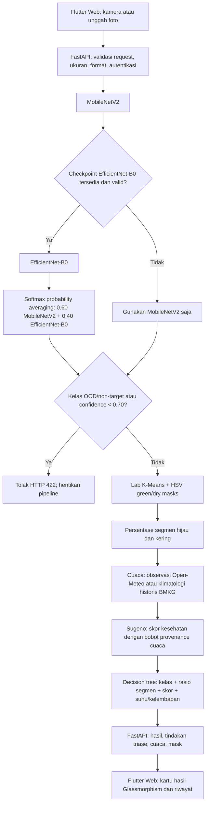

# Draf Panduan Berkas Pendukung HKI LEAF LENS

Dokumen ini adalah kerangka kerja untuk dibahas dengan prodi atau sentra HKI.
Persyaratan, format, jumlah salinan, dan redaksi resmi dapat berbeda; konfirmasi
formulir dan panduan terbaru institusi sebelum mencetak atau menandatangani.
Pendaftaran Hak Cipta Program Komputer dan penilaian Paten/Paten Sederhana
memiliki dasar dan persyaratan berbeda. Dokumen ini tidak menyatakan bahwa
kebaruan atau kelayakan paten telah terbukti.

## 1. Diagram alur arsitektur

Ensemble merupakan jalur bersyarat: pada checkout ini belum ada checkpoint
EfficientNet-B0 proyek yang siap dipakai. Karena itu, alur standar berjalan
dengan MobileNetV2 saja sampai checkpoint sekunder dilatih, dievaluasi, dan
dikonfigurasi melalui `PLANT_SECONDARY_MODEL_PATH`. Rasio pembobotan merupakan
konfigurasi implementasi, bukan klaim bahwa ensemble telah meningkatkan
akurasi.

## 2. Struktur Dokumen Deskripsi Ciptaan

Gunakan struktur berikut sebagai draf dan sesuaikan dengan formulir prodi:

1. **Judul ciptaan** — LEAF LENS: Aplikasi Monitoring Kondisi Tanaman Berbasis
   Hybrid AI dan Data Cuaca.
2. **Identitas pencipta/pemegang hak** — nama, alamat, institusi, NIM bila
   diminta, serta dasar hubungan kepemilikan.
3. **Ringkasan ciptaan** — tujuan, pengguna, perangkat, serta batasan bahwa
   hasil merupakan skrining foto.
4. **Latar belakang dan tujuan** — masalah pemantauan, konteks penggunaan,
   sasaran fitur.
5. **Kebutuhan sistem dan lingkungan** — Flutter Web, FastAPI, runtime,
   autentikasi, storage, dan perangkat yang didukung.
6. **Arsitektur dan alur data** — diagram pada dokumen ini, format request/API,
   serta alur data dan penyimpanan.
7. **Rincian modul** — antarmuka, autentikasi, pipeline klasifikasi, OOD,
   segmentasi, fuzzy/weather, rekomendasi, serta riwayat.
8. **Algoritma dan parameter** — hanya rincikan algoritma/parameter yang dapat
   ditunjuk pada source code dan hasil uji. Tandai checkpoint EfficientNet
   sebagai opsional sampai tersedia.
9. **Spesifikasi masukan dan keluaran** — format citra, koordinat/cuaca,
   rasio/mask, kelas, skor, dan bentuk rekomendasi.
10. **Pengujian dan hasil** — versi source, lingkungan, test suite, sumber data,
    pemisahan train/validation/test, metrik, dan keterbatasan.
11. **Batasan dan keselamatan penggunaan** — domain tanaman yang didukung,
    risiko salah klasifikasi, kebutuhan verifikasi ahli, dan peringatan agar
    rekomendasi tidak diperlakukan sebagai resep pestisida.
12. **Orisinalitas kontribusi dan materi eksternal** — daftar kode buatan
    pencipta, kontribusi manusia lain, lisensi data/model/library/aset, dan
    batas kepemilikan sebagaimana inventaris
    [LEGAL_ATTRIBUTION.md](./LEGAL_ATTRIBUTION.md).
13. **Lampiran** — panduan pengguna, sampel layar, laporan tes, inventaris
    source, hash arsip, dan formulir resmi yang diminta prodi.

Untuk permohonan paten/paten sederhana, jangan memakai deskripsi program
komputer ini sebagai pengganti dokumen teknis yang diwajibkan. Minta penilaian
unit HKI/penasihat berwenang tentang subjek yang dapat dilindungi, klaim,
kebaruan, langkah inventif, penerapan industri, dan publikasi terdahulu.

## 3. Petunjuk menyiapkan cetakan source code

Ikuti instruksi jumlah halaman dari prodi. Jika diminta 50 halaman pertama dan
50 halaman terakhir:

1. Bekukan versi source yang akan diajukan; catat commit/hash arsip dan tanggal.
2. Tentukan daftar file source relevan yang benar-benar menjadi bagian ciptaan,
   misalnya `backend/main.py`, `backend/segmentation.py`,
   `backend/fuzzy_logic.py`, `backend/care_recommendations.py`,
   `backend/weather.py`, `backend/train_plant_model.py`,
   `web/lib/screens/scan_screen.dart`, `web/lib/models/plant_analysis.dart`,
   `web/lib/services/plant_api_service.dart`, dan modul UI terkait.
3. Jangan mencetak `.env`, kredensial, file database pengguna, cache,
   environment, binary checkpoint, dataset, file build, atau source dependency
   pihak ketiga sebagai karya sendiri.
4. Buat salinan gabungan khusus pencetakan dengan urutan file yang konsisten.
   Tambahkan halaman sampul/daftar file bila diminta; jangan mengubah source
   dalam arsip utama.
5. Beri nomor halaman kontinu. Tandai berkas dan rentang source pada daftar
   lampiran agar halaman cetak dapat dicocokkan dengan arsip digital.
6. Cetak halaman 1–50 dan 50 halaman paling akhir dari dokumen gabungan sesuai
   definisi prodi. Jika total halaman kurang dari 100, jangan menggandakan atau
   mengisi halaman kosong tanpa persetujuan petugas.
7. Cocokkan hasil cetak dengan PDF final, pastikan teks terbaca, tidak terpotong,
   dan versi/hashes sesuai. Simpan PDF sumber yang dipakai untuk mencetak.

Panduan ini tidak menetapkan format font, margin, pengesahan, atau jumlah
rangkap karena hal tersebut harus mengikuti ketentuan resmi prodi.

## 4. Template draf Surat Pernyataan Hak Cipta

> **SURAT PERNYATAAN KEPEMILIKAN / PENCIPTAAN PROGRAM KOMPUTER**
> *(Draf untuk ditinjau dan diganti dengan formulir resmi prodi/kampus)*
>
> Saya yang bertanda tangan di bawah ini:
> Nama: **[nama lengkap]**
> NIM/identitas: **[nomor identitas bila diperlukan]**
> Program studi/institusi: **[program studi dan institusi]**
> Alamat: **[alamat]**
>
> Menyatakan bahwa program komputer berjudul **“LEAF LENS: Aplikasi
> Monitoring Kondisi Tanaman Berbasis Hybrid AI dan Data Cuaca”** adalah karya
> yang saya ajukan untuk pencatatan/pemeriksaan HKI. Bagian yang saya nyatakan
> sebagai kontribusi saya adalah **[uraikan modul dan peran secara faktual]**.
>
> Saya telah mengungkapkan kontribusi pihak lain dan penggunaan framework,
> library, model, dataset, font, ilustrasi, serta materi eksternal pada daftar
> atribusi terlampir. Pernyataan ini tidak mengalihkan atau mengklaim hak atas
> materi pihak ketiga. Status kepemilikan institusi dan persetujuan para
> kontributor telah/akan dikonfirmasi sesuai ketentuan **[nama institusi]**.
>
> Saya bersedia memberikan klarifikasi dan bukti yang relevan. Saya memahami
> bahwa keputusan pencatatan/pemeriksaan mengikuti ketentuan yang berlaku.
>
> **[Kota], [tanggal]**
> Yang menyatakan,
> Materai/tanda tangan sesuai ketentuan resmi: **[ruang tanda tangan]**
> Nama jelas: **[nama lengkap]**

Jangan menandatangani pernyataan yang tidak sesuai fakta. Periksa istilah
“pencipta”, “pemegang hak”, kontribusi dosen/pembimbing, status karya dalam
lingkungan kampus, serta kewajiban materi sebelum menyerahkan dokumen.
