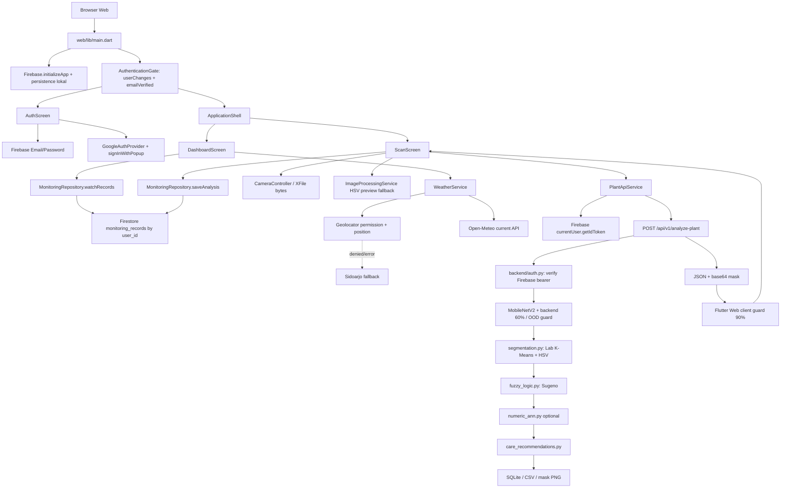

# Laporan Project-Based Learning (PBL)

## Sistem Monitoring Kesehatan Tanaman Jagung, Kentang, dan Tomat Berbasis Hybrid AI

**Tanggal penyusunan:** 6 November 2026  
**Sumber metrik evaluasi:** `outputsApp/pbl_plantvillage_metrics.json`

### Abstrak

Penyakit daun pada jagung, kentang, dan tomat dapat menurunkan hasil panen
apabila gejala terlambat diketahui. Proyek ini mengembangkan aplikasi web untuk
skrining visual daun dengan menggabungkan Flutter Web, FastAPI, MobileNetV2,
segmentasi warna K-Means dan HSV, fuzzy Sugeno, data cuaca, serta jalur ANN
numerik opsional. MobileNetV2 memilih satu dari 19 kelas dan menolak prediksi
kelas `Background_or_Invalid` atau confidence di bawah 60% pada backend.
Flutter Web saat ini masih mempunyai guard tambahan 90%, sehingga kedua batas
belum konsisten. Untuk gambar yang lolos kedua pemeriksaan, segmentasi menghasilkan rasio area hijau dan kering; nilai tersebut
dipakai fuzzy Sugeno untuk menghitung skor kesehatan dan tingkat keparahan.
Data cuaca dari Open-Meteo atau fallback klimatologi BMKG dapat menyesuaikan
risiko penyakit blight. Hasil ditampilkan melalui Flutter Web dan disimpan pada
riwayat aplikasi. Fine-tuning terbaru menggunakan 29.028 gambar pelatihan dan
7.014 gambar validasi setelah penghapusan duplikat byte-identik. Checkpoint
terpilih memperoleh akurasi 98,66% dan macro F1 94,88% pada split validasi.
ANN numerik belum dilatih karena proyek belum memiliki data observasi numerik
dengan label ground-truth dan fitur cuaca yang berpasangan.

**Kata kunci:** klasifikasi penyakit daun, MobileNetV2, K-Means, HSV, fuzzy
Sugeno, cuaca, Flutter Web, FastAPI.

## 1. Judul Proyek dan Latar Belakang

**Judul:** Sistem Monitoring Kesehatan Tanaman Jagung, Kentang, dan Tomat
Berbasis Hybrid AI.

Petani perlu mengenali gejala penyakit daun secara cepat agar tanaman yang
terinfeksi dapat diperiksa dan ditangani lebih awal. Pemeriksaan manual dapat
berbeda antar-pengamat dan memerlukan pengalaman mengenali gejala. Aplikasi ini
menyediakan skrining awal dari foto, pengukuran visual area hijau/kering,
penilaian kesehatan berbasis aturan, dan saran perawatan terstruktur.

Sistem ini merupakan alat bantu skrining, bukan diagnosis agronomi atau resep
pestisida. Keputusan penanganan tetap perlu mempertimbangkan kondisi kebun,
label produk, aturan setempat, dan saran penyuluh atau ahli tanaman.

## 2. Rancangan Arsitektur Hybrid AI dan Sistem

### 2.1 Alur data dari foto sampai hasil

```text
Kamera / unggah foto Flutter Web
    → request multipart asinkron ke FastAPI
    → decode gambar dan MobileNetV2
    → guardrail backend: kelas OOD/non-target atau confidence < 60% → HTTP 422
    → untuk prediksi yang lolos: K-Means Lab + filter HSV
    → rasio hijau/kering dan mask
    → Open-Meteo (atau fallback historis BMKG bila koordinat ada)
    → fuzzy Sugeno untuk skor kesehatan dan severity
    → ANN numerik hanya bila checkpoint valid dan cuaca tersedia
    → rekomendasi perawatan, respons API, penyimpanan, dan kartu hasil Flutter
```

Guardrail OOD backend dijalankan sebelum segmentasi, fuzzy, rekomendasi, serta
penyimpanan riwayat. Guard client Web masih memakai batas confidence 90% setelah
respons sukses diterima; confidence 60% sampai kurang dari 90% dapat sudah
diproses dan disimpan backend, tetapi kemudian ditolak oleh Flutter. Endpoint
analisis FastAPI menjalankan kerja citra berat pada thread
pool agar event loop API tidak menahan request lain. Request jaringan pada
Flutter menggunakan `async`/`await`; pratinjau gambar memakai batas ukuran
decode agar tidak perlu merender ulang seluruh gambar resolusi tinggi.

### 2.2 MobileNetV2: klasifikasi dan penyaring OOD

MobileNetV2 adalah classifier utama citra daun. Gambar diubah ke RGB,
di-resize ke 256 × 256, dinormalisasi dengan mean dan simpangan baku ImageNet,
lalu diproses menjadi probabilitas untuk 19 kelas.

Kelas keluaran terdiri dari 18 kelas daun (jagung, kentang, tomat) dan satu
kelas `Background_or_Invalid`. Backend mengembalikan HTTP 422 dengan kode
`ood_image` bila kelas teratas adalah OOD, tidak termasuk tiga jenis tanaman,
confidence bukan angka valid, atau confidence kurang dari `0.60` (60%).
Confidence yang diteruskan dari classifier backend disimpan sebagai persen;
validasi membaginya dengan 100 sebelum membandingkan dengan threshold desimal.
Foto yang ditolak backend tidak diteruskan ke segmentasi/fuzzy dan tidak
disimpan oleh backend.

`web/lib/services/plant_api_service.dart` masih menetapkan
`minimumConfidencePercent = 90.0`. Ini pemeriksaan terpisah setelah backend
mengembalikan HTTP 2xx. Prediksi 60% sampai kurang dari 90% berpotensi tetap
menjalankan segmentasi, fuzzy, dan penyimpanan backend, lalu dianggap OOD oleh
client dan tidak ditampilkan sebagai hasil analisis. Confidence softmax bukan
probabilitas terkalibrasi bahwa prediksi benar.

### 2.3 K-Means dan HSV: segmentasi warna

Implementasi berada di `backend/segmentation.py`. Algoritma ini tidak memberi
nama penyakit dan tidak mengenali daun secara semantik.

1. Citra BGR diperkecil sehingga sisi terpanjang paling besar 640 piksel.
2. Citra diubah ke ruang HSV dan CIE-Lab.
3. Sampel warna Lab dibatasi sekitar 20.000 titik; K-Means++ mencari sampai
   tiga pusat warna, maksimal 25 iterasi, dua percobaan, seed OpenCV 7.
4. Semua piksel dikelompokkan ke pusat Lab terdekat dalam chunk untuk
   membatasi penggunaan memori.
5. Warna pusat cluster diperiksa dengan ambang HSV, lalu hasilnya dipotong lagi
   dengan mask HSV per piksel.
6. Operasi morfologi opening mengurangi noise dan closing mengisi celah.
   Kernel default 5 × 5; komponen terhubung yang terlalu kecil dihapus.
7. Rasio dihitung terhadap seluruh piksel citra kerja:
   `jumlah piksel mask / total piksel × 100%`.
8. Mask keluaran memakai putih untuk hijau, abu-abu untuk kering, dan hitam
   untuk area yang tidak masuk mask.

K-Means membantu mengelompokkan warna, sedangkan HSV menetapkan rentang warna
yang relevan. Rumput, kain hijau, kulit, atau latar berwarna serupa dapat
memengaruhi rasio karena segmentasi ini bukan detektor objek daun.

Flutter Web mempunyai fallback HSV sederhana saat API tidak tersedia. Fallback
tersebut bukan K-Means, tidak menghasilkan klasifikasi MobileNetV2, dan tidak
boleh dianggap sebagai diagnosis AI backend.

### 2.4 Fuzzy Logic Sugeno: skor kesehatan dan severity

Implementasi berada di `backend/fuzzy_logic.py`. Masukan utama adalah rasio
hijau dan kering. Nilai dibatasi ke rentang 0–100; bila hijau kurang dari 2%
dan kering kurang dari 3%, hasil ditandai `Tidak diketahui`.

Derajat keanggotaan menggunakan shoulder dan segitiga:

| Fitur | Rendah | Sedang | Tinggi |
|---|---|---|---|
| Hijau | penuh pada 0%, turun menjadi 0 di 20% | segitiga 5–30–60% | mulai naik di 25%, penuh di 65% |
| Kering | penuh pada 0%, turun menjadi 0 di 12% | segitiga 3–15–35% | mulai naik di 20%, penuh di 50% |

Basis aturan Sugeno zero-order berisi sembilan kombinasi berikut. Bobot aturan
adalah nilai minimum dari membership hijau dan kering; skor dihitung dengan
rata-rata berbobot `Σ(bobot × konsekuen) / Σ(bobot)`.

| Hijau | Kering rendah | Kering sedang | Kering tinggi |
|---|---:|---:|---:|
| Tinggi | 95 | 76 | 48 |
| Sedang | 78 | 54 | 30 |
| Rendah | 52 | 32 | 12 |

Nilai akhir dibatasi ke 0–100. Severity `Sehat` diberikan untuk skor ≥75,
`Perlu perhatian` untuk skor ≥50 dan <75, serta `Kritis` untuk skor <50.
Apabila kondisi cuaca tersedia dan nama penyakit mengandung “blight”, aturan
risiko hangat/lembap/hujan dapat mengurangi skor maksimal 15 poin. Penyesuaian
ini adalah indikator risiko, bukan diagnosis cuaca atau penyakit.

### 2.5 Data cuaca

`backend/weather.py` meminta data kondisi saat ini dari Open-Meteo Forecast API
jika latitude dan longitude diberikan. Variabel yang dipakai adalah suhu,
kelembapan relatif, dan curah hujan. Request memiliki timeout empat detik dan
memvalidasi rentang nilainya.

Jika Open-Meteo gagal, backend mencari stasiun BMKG terdekat lalu memakai
rata-rata bulanan dari `backend/climate_data_idn.csv/` (data historis
2010–2020). Tanpa koordinat, data cuaca tidak tersedia; fuzzy tetap dapat
menghitung skor dari rasio daun, tetapi penyesuaian cuaca dan inferensi ANN
tidak berjalan.

### 2.6 ANN numerik

`backend/numeric_ann.py` adalah jaringan kecil NumPy yang berbeda dari
MobileNetV2. Skema inferensi yang disiapkan menerima sepuluh fitur:

1. `green_ratio`
2. `dry_ratio`
3. `mobilenet_confidence`
4. `fuzzy_health_score`
5. `mean_hue`
6. `mean_saturation`
7. `mean_value`
8. `temperature_c`
9. `humidity_pct`
10. `precipitation_mm`

Label yang diharapkan adalah `healthy`, `dry`, atau `infected`. Trainer
`backend/train_numeric_ann.py` memerlukan CSV observasi yang mempunyai
ground-truth label, split validasi, serta cuaca yang berpasangan dengan
observasi yang sama. API otomatis mencari
`backend/numeric_ann_weights.json`; variabel `PLANT_NUMERIC_ANN_WEIGHTS` dapat
memilih checkpoint lain. API tidak mengganti model yang belum dilatih dengan
bobot acak dan UI menunjukkan bila ANN belum tersedia.

**Status saat laporan ini dibuat:** bobot `backend/numeric_ann_weights.json`
belum dibuat. CSV monitoring yang tersedia berisi prediksi/kondisi hasil
aplikasi, bukan label ground-truth independen; data tersebut juga tidak
memiliki seluruh sepuluh fitur cuaca dan citra yang diperlukan. CSV cuaca BMKG
hanya berisi observasi cuaca, bukan label kesehatan daun. Membuat target ANN
dengan menyalin keluaran fuzzy atau prediksi model lain akan menghasilkan
label sirkular, sehingga tidak dilakukan. ANN baru layak dilatih setelah data
berlabel yang representatif tersedia.

### 2.7 Rekomendasi penanganan

`backend/care_recommendations.py` menyusun prioritas tindakan berdasarkan
tanaman, penyakit, confidence, skor kesehatan, kondisi kering, dan cuaca.
Respons memisahkan tindakan darurat, rekomendasi organik/hayati, opsi
fungisida/bakterisida kimiawi berdasarkan bahan aktif, serta dampak bila tidak
ditangani. Informasi tersebut merupakan saran awal yang tetap harus diperiksa
dengan label produk dan panduan agronomi setempat.

## 3. Spesifikasi Dataset dan Kelas

### 3.1 Struktur dan sumber data

Dataset classifier berada pada satu struktur aktif:

```text
PlantVillage/
├── train/<nama-kelas>/<gambar>
└── val/<nama-kelas>/<gambar>
```

Folder kelas menjadi label untuk `torchvision.datasets.ImageFolder`. Trainer
hanya mempertahankan awalan `Corn_(maize)___`, `Potato___`, `Tomato___`, serta
folder persis `Background_or_Invalid`.

Dataset merupakan gabungan kelas PlantVillage, kelas PlantDoc yang dipetakan
ke tiga tanaman tersebut, dan contoh non-daun di `Background_or_Invalid`.
Kelas PlantDoc generik `Tomato_leaf` dipetakan menjadi
`Tomato___Unspecified_leaf`, bukan dianggap sehat. OOD mencakup cats/dogs dan
contoh wajah serta objek COCO128 yang ditambahkan ke dataset. Penambahan terbaru
yang diinformasikan adalah 160 gambar training dan 40 gambar validation.

Repository tidak menyimpan URL/slug dan versi Kaggle yang persis untuk dataset
PlantVillage sumber. Karena itu identitas halaman Kaggle asal tidak dapat
dipastikan dari bukti di repository dan tidak dicantumkan sebagai klaim.
Untuk pengambilan ulang, pilih halaman dataset berlisensi sesuai kebutuhan,
catat pemilik, slug, versi dan lisensi, lalu unduh dengan Kaggle CLI:

```sh
python -m pip install kaggle
kaggle datasets download -d <owner>/<slug> -p DataSet --unzip
```

Setelah unduhan, periksa folder kelas dan lisensi, pisahkan data train/val tanpa
duplikasi, dan pertahankan sampel non-daun berlabel OOD. Jangan memakai data
validation untuk pembaruan gradient.

### 3.2 Rincian kelas dan jumlah sampel

Jumlah pada kolom validation adalah support pada evaluasi final, yaitu setelah
10 file validation byte-identik dengan train dikeluarkan.

| Kelas | Train | Validation |
|---|---:|---:|
| `Background_or_Invalid` | 8.165 | 2.063 |
| Corn – Cercospora/Gray leaf spot | 473 | 106 |
| Corn – Common rust | 1.060 | 249 |
| Corn – Northern Leaf Blight | 970 | 207 |
| Corn – healthy | 929 | 233 |
| Potato – Early blight | 957 | 214 |
| Potato – Late blight | 1.000 | 207 |
| Potato – healthy | 121 | 31 |
| Tomato – Bacterial spot | 1.803 | 433 |
| Tomato – Early blight | 879 | 209 |
| Tomato – Late blight | 1.628 | 389 |
| Tomato – Leaf Mold | 846 | 197 |
| Tomato – Septoria leaf spot | 1.562 | 366 |
| Tomato – Spider mites | 1.343 | 335 |
| Tomato – Target Spot | 1.123 | 281 |
| Tomato – Yellow Leaf Curl Virus | 4.509 | 1.086 |
| Tomato – mosaic virus | 343 | 84 |
| Tomato – unspecified leaf | 44 | 8 |
| Tomato – healthy | 1.273 | 316 |
| **Total** | **29.028** | **7.014** |

Sebelum penyaringan duplikat, ImageFolder menemukan 7.024 gambar validation.
Trainer membandingkan SHA-256 isi file train dan validation; 10 duplikat persis
dikeluarkan hanya dari evaluasi dan tidak mengubah file dataset.

## 4. Hasil Evaluasi Model dan Metrik Performa

### 4.1 Konfigurasi pelatihan terakhir

| Parameter | Nilai |
|---|---|
| Model | MobileNetV2; checkpoint backbone lama digunakan, classifier head 19 kelas dibuat ulang |
| Input model | RGB 256 × 256; `Resize((256,256))` merentangkan gambar ke ukuran tetap |
| Epoch diminta | 3; early stopping nonaktif (`patience=0`) |
| Batch | 32; 908 batch per epoch |
| Optimizer | AdamW, learning rate 0,0001, weight decay 0,0001 |
| Loss | CrossEntropy berbobot kelas berbanding terbalik dengan akar jumlah sampel |
| Augmentasi | Flip horizontal, rotasi ±10°, ColorJitter brightness/contrast/saturation 0,2, RandomGrayscale p=0,1 |
| Pemilihan checkpoint | Macro F1 validation tertinggi |
| Seed / device | 42 / Apple Silicon MPS |

Walaupun tiga epoch dijalankan, checkpoint terbaik adalah epoch 1 karena
macro F1-nya tertinggi. Epoch lebih banyak tidak otomatis menghasilkan model
lebih baik; checkpoint dipilih dari metrik validasi, bukan sekadar epoch
terakhir.

### 4.2 Metrik checkpoint terpilih

| Metrik | Hasil |
|---|---:|
| Validation loss | 0,04855 |
| Accuracy | 98,66% |
| Macro precision | 94,26% |
| Macro recall | 95,86% |
| Macro F1-score | 94,88% |
| Sampel validation dievaluasi | 7.014 |
| Support kelas OOD | 2.063 |
| Precision/recall/F1 `Background_or_Invalid` | 99,95% / 99,95% / 99,95% |

Akurasi pada berkas metrik adalah 0,9865982321 atau 98,6598%; angka pada
tabel dibulatkan menjadi 98,66% hingga dua angka desimal.

Distribusi confidence adalah nilai maksimum softmax di seluruh kelas pada
split validation, bukan metrik khusus non-daun. Berkas metrik historis mencatat
threshold 60%. Nilai itu metadata evaluasi saat laporan tersebut dibuat,
bukan bukti nilai runtime. Saat ini trainer mendefinisikan threshold evaluasi
90%, backend memakai 60%, dan guard Flutter Web memakai 90%; karena konfigurasi
berbeda, evaluasi ulang diperlukan untuk laporan baru yang konsisten:

| Rentang confidence | Jumlah | Persentase |
|---|---:|---:|
| <60% | 58 | 0,83% |
| 60%–<80% | 73 | 1,04% |
| 80%–<90% | 94 | 1,34% |
| ≥90% | 6.789 | 96,79% |

Tabel riwayat memperlihatkan loss training turun, tetapi macro F1 validation
tidak meningkat monoton:

| Epoch | Train loss | Validation loss | Accuracy | Macro F1 | Confidence <60% |
|---:|---:|---:|---:|---:|---:|
| 1 | 0,13797 | 0,04855 | 98,66% | 94,88% | 58 |
| 2 | 0,09271 | 0,05530 | 98,45% | 94,36% | 54 |
| 3 | 0,07436 | 0,04715 | 98,55% | 94,79% | 51 |

Hasil per kelas tidak seragam. Sebagai contoh, kelas `Tomato___Unspecified_leaf`
hanya mempunyai delapan sampel validation dan F1 47,62%; angka ini sangat
tidak pasti dan menunjukkan kebutuhan penambahan data. Akurasi tinggi pada
split ini bukan bukti performa lapangan, jaminan semua wajah ditolak, ataupun
probabilitas prediksi benar sebesar nilai confidence.

### 4.3 Berkas model dan evaluasi

- Checkpoint classifier: `backend/model_daun_plantvillage_full_train.pth`
  (9.242.571 byte; loader backend berhasil memuat 19 kelas).
- Laporan mesin: `outputsApp/pbl_plantvillage_metrics.json`, berisi konfigurasi,
  kelas, riwayat epoch, loss, accuracy, precision, recall, F1, confusion matrix,
  dan distribusi confidence.
- Bobot ANN numerik: belum tersedia karena dataset numerik berlabel belum ada;
  tidak dibuat menggunakan label sintetis.

## 5. Arsitektur Kode dan Struktur Direktori

| Lokasi/file | Fungsi |
|---|---|
| `backend/main.py` | FastAPI routes, autentikasi, pemuatan MobileNetV2, OOD guard, orkestrasi inferensi, penyimpanan SQLite/CSV/mask |
| `backend/train_plant_model.py` | Filter kelas, augmentasi, fine-tuning, evaluasi dan simpan checkpoint classifier |
| `backend/prepare_dataset.py` | Dry-run atau penerapan pemindahan dan penyaringan kelas dataset |
| `backend/segmentation.py` | K-Means Lab, filter HSV, morfologi, rasio warna, fitur HSV numerik |
| `backend/fuzzy_logic.py` | Membership, aturan Sugeno, skor kesehatan dan severity |
| `backend/weather.py` | Open-Meteo dan fallback rata-rata bulanan BMKG |
| `backend/numeric_ann.py` | Implementasi ANN NumPy, normalisasi, training/inference API, serialisasi checkpoint |
| `backend/train_numeric_ann.py` | Pelatihan ANN dari CSV berlabel dan laporan validasi |
| `backend/care_recommendations.py` | Prioritas, rekomendasi organik/kimiawi dan dampak penyakit |
| `backend/auth.py`, `backend/compact_context.py` | Verifikasi Firebase dan payload hasil ringkas deterministik |
| `backend/tests/test_logic.py` | Unit test logika, model, fuzzy, cuaca, OOD, dataset, ANN |
| `web/lib/main.dart` | Inisialisasi Firebase, route autentikasi dan shell aplikasi |
| `web/lib/screens/auth_screen.dart` | Login/daftar Email-Password dan Google OAuth |
| `web/lib/screens/dashboard_screen.dart` | Ringkasan, stream riwayat, widget cuaca dan rekomendasi penyiraman |
| `web/lib/screens/scan_screen.dart` | Kamera/upload, request async, warning card OOD, kartu hasil |
| `web/lib/screens/history_screen.dart` | Daftar, ekspor dan penghapusan riwayat pengguna |
| `web/lib/services/plant_api_service.dart` | Multipart request Bearer ke FastAPI dan safeguard client confidence 90% |
| `web/lib/services/image_processing_service.dart` | HSV lokal untuk fallback dan thumbnail; bukan implementasi K-Means |
| `web/lib/services/monitoring_repository.dart` | Penyimpanan dan riwayat Firestore yang terkait pengguna |
| `web/lib/services/weather_service.dart` | Geolokasi, Open-Meteo, fallback Sidoarjo dan keputusan penyiraman |
| `web/lib/models/plant_analysis.dart` | Struktur data hasil analisis yang ditampilkan |
| `web/lib/widgets/` | Permukaan glass, ilustrasi, backdrop, animasi/press interactions; Stateless visual atau Stateful animation |
| `web/lib/theme/app_theme.dart` | Color tokens, typography fallback, component themes |
| `web/test/` | Widget, service, API guard, dashboard responsive tests |
| `web/assets/` | Aset visual aktif dan `models/mr_potato_head.glb`; file tak terpakai sudah dihapus |
| `PlantVillage/train/`, `PlantVillage/val/` | Dataset sumber kebenaran untuk 19 kelas model gambar |
| `outputsApp/pbl_plantvillage_metrics.json` | Hasil evaluasi dan riwayat training |
| `outputsApp/monitoring_api.sqlite3`, `monitoring_api.csv`, `masks/` | Riwayat dan mask hasil backend |

`web/` juga perlu menyimpan `pubspec.yaml`, lockfile, Firebase options/rules,
konfigurasi build dan aset; file konfigurasi itu tidak dipindahkan karena
diperlukan untuk menjalankan aplikasi. Repository juga memiliki `mobile/` dan
skrip eksperimen lama yang terpisah dari jalur utama Flutter Web + FastAPI.
Folder tersebut tidak dihapus atau digabung tanpa pemeriksaan penggunaan dan
riwayat yang lebih lengkap.

### Input dan output utama

| Jenis | Sumber/tujuan |
|---|---|
| Foto analisis | JPEG, PNG, atau WebP dari kamera/galeri Flutter |
| Gambar training | `PlantVillage/train/<kelas>/` dan `PlantVillage/val/<kelas>/` |
| Fitur ANN | CSV numerik 10 fitur dan label ground-truth; belum tersedia |
| Cuaca historis | `backend/climate_data_idn.csv/` |
| Riwayat Web | Firestore `monitoring_records`, dibatasi pada pengguna login |
| Riwayat backend | `outputsApp/monitoring_api.sqlite3` dan `monitoring_api.csv` |
| Mask API | `outputsApp/masks/` |
| Checkpoint gambar | `backend/model_daun_plantvillage_full_train.pth` |
| Metrik classifier | `outputsApp/pbl_plantvillage_metrics.json` |

## 6. Panduan Pengujian dan Menjalankan Aplikasi

### 6.1 Menjalankan backend FastAPI

Dari root repository:

```sh
python3 -m venv .venv-api
source .venv-api/bin/activate
python -m pip install -r backend/requirements.txt
PLANT_REQUIRE_AUTH=false python -m uvicorn backend.main:app \
  --reload --host 127.0.0.1 --port 8000
```

`PLANT_REQUIRE_AUTH=false` hanya untuk demo lokal. Deployment publik harus
menggunakan Firebase ID token, konfigurasi Firebase Admin yang aman, HTTPS, dan
origin yang diizinkan.

### 6.2 Menjalankan Flutter Web

Terminal kedua, dari root repository:

```sh
cd web
flutter pub get
flutter run -d chrome --web-port 5001 \
  --dart-define=PLANT_API_URL=http://localhost:8000
```

Jika Chrome device tidak tersedia, jalankan server web Flutter:

```sh
flutter run -d web-server --web-hostname 127.0.0.1 --web-port 5001 \
  --dart-define=PLANT_API_URL=http://localhost:8000
```

Firebase Email/Password Authentication dan Cloud Firestore harus aktif untuk
login dan riwayat. Jalur analisis API juga memerlukan Firebase token pada mode
autentikasi default. URL API dapat diganti melalui
`--dart-define=PLANT_API_URL=<alamat-backend>`.

### 6.3 Menjalankan pengujian

```sh
./.venv-api/bin/python -m unittest backend.tests.test_logic
cd web && flutter analyze && flutter test
```

Pengujian terakhir pada audit ini: **38 unit test backend**, **36 Web tests**,
dan **10 Mobile tests lulus**; analyzer kedua target bersih. Build release
Flutter Web berhasil. Pemeriksaan browser pada layar login di lebar 320, 390,
768, 900, 1024, dan 1.440 piksel tidak menemukan exception layout. Build melaporkan
peringatan dry-run WebAssembly dari dependensi `flutter_tts`; build Web standar
tetap berhasil. Tidak ada pengukuran perangkat nyata yang membuktikan target
60–120 FPS.

## 7. Kesimpulan dan Rekomendasi Pengembangan

Proyek menggabungkan classifier citra terlatih, segmentasi berbasis warna,
inferensi fuzzy, data cuaca, rekomendasi, dan aplikasi web. MobileNetV2
bertanggung jawab atas label penyakit; K-Means/HSV mengukur bagian warna;
Sugeno menghitung skor dan severity; ANN numerik adalah modul tambahan yang
belum diaktifkan untuk prediksi karena belum mempunyai data berlabel yang
valid. Pemisahan tugas ini penting saat menjelaskan cara kerja aplikasi.

Rekomendasi berikutnya:

1. Tambahkan OOD beragam dari kamera lapangan dan evaluasi false acceptance,
   rejection recall, serta in-distribution rejection rate pada test set
   terpisah.
2. Tambah gambar validation untuk kelas kecil, terutama
   `Tomato___Unspecified_leaf`, dan periksa pembagian train/validation terhadap
   kemiripan selain duplikat byte-identik.
3. Kumpulkan observasi numeric berlabel oleh ahli, dengan fitur citra dan cuaca
   pada waktu/lokasi yang sama; setelah itu baru latih serta validasi ANN.
4. Ukur waktu inferensi, penggunaan memori dan kelancaran di perangkat nyata
   dengan koneksi lambat dan foto resolusi tinggi; jangan menyimpulkan FPS dari
   unit test atau build.
5. Kalibrasi confidence, evaluasi beberapa threshold, serta validasi pada
   varietas, kamera, pencahayaan dan kondisi lapangan yang berbeda.
6. Setelah mengganti checkpoint, restart FastAPI agar proses yang sedang
   berjalan memuat bobot terbaru.

## 8. Peta Struktur Direktori dan Tanggung Jawab File

### 8.1 Peta direktori aktual

```text
Project_Klasifikasi_Daun/
├── backend/
│   ├── auth.py
│   ├── care_recommendations.py
│   ├── compact_context.py
│   ├── fuzzy_logic.py
│   ├── main.py
│   ├── numeric_ann.py
│   ├── prepare_dataset.py
│   ├── segmentation.py
│   ├── train_numeric_ann.py
│   ├── train_plant_model.py
│   ├── weather.py
│   ├── requirements.txt
│   ├── tests/test_logic.py
│   └── climate_data_idn.csv/{climate_data,province_detail,station_detail}.csv
├── web/
│   ├── lib/
│   │   ├── main.dart
│   │   ├── firebase_options.dart
│   │   ├── models/plant_analysis.dart
│   │   ├── screens/{auth,dashboard,history,scan}_screen.dart
│   │   ├── services/{image_processing,monitoring_repository,plant_api,weather}_service.dart
│   │   ├── theme/app_theme.dart
│   │   └── widgets/{garden_artwork,glass_surface,plant_backdrop,soft_motion}.dart
│   ├── assets/                 # latar, ilustrasi, mr_potato_head.glb
│   ├── test/                   # widget, service, API dan cuaca
│   ├── web/index.html          # bootstrap, viewport, metadata, model-viewer module
│   ├── pubspec.yaml / pubspec.lock
│   ├── firebase.json / firestore.rules / firestore.indexes.json
│   └── analysis_options.yaml
├── mobile/                     # aplikasi Flutter mobile terpisah
├── PlantVillage/{train,val}/   # dataset classifier; tidak dibersihkan oleh cleanup mask
├── outputsApp/                 # output runtime/lokal; diabaikan Git
├── .gitignore
├── DEPLOYMENT.md
├── README.md / ANALISIS_PROJECT.md / LAPORAN_PBL.md
└── checkpoint .pth dan skrip eksperimen lama di root
```

### 8.2 Peta file menurut Single Responsibility

| Lokasi | Tipe komponen | Tanggung jawab dan alasan penempatan |
|---|---|---|
| `web/lib/main.dart` | App composition/stateful shell | Inisialisasi Firebase, persistence Web, auth gate, navigasi tab dan pemilik lifecycle shell. Entry point UI menghubungkan screen tanpa menyimpan algoritme ML. |
| `web/lib/firebase_options.dart` | Konfigurasi | Opsi Firebase publik per platform; bukan kredensial Admin dan bukan tempat menyimpan secret. |
| `web/lib/screens/auth_screen.dart` | Stateful UI + auth orchestration | Form email/password, verifikasi, Google popup, feedback error, dan hero 3D. Controller form dibuat/dibuang oleh screen ini. |
| `web/lib/screens/dashboard_screen.dart` | UI + state cuaca | Ringkasan, stream record pengguna, lokasi/cuaca, dan rekomendasi penyiraman. `FutureBuilder` cuaca terpisah dari stream Firestore. |
| `web/lib/screens/scan_screen.dart` | Stateful UI/orchestrator | Kamera, upload, parameter HSV, multipart request, warning OOD, preview, dan hasil. Tidak menjalankan MobileNetV2 di browser. |
| `web/lib/screens/history_screen.dart` | Stateful UI | Pencarian, ekspor, dan penghapusan record; akses data tetap melalui repository milik akun aktif. |
| `web/lib/models/plant_analysis.dart` | Data model | Struktur immutable `PlantAnalysis`, normalized bounds, dan segmentation result agar UI tidak mengoperasikan map bebas untuk hasil analisis. |
| `web/lib/services/image_processing_service.dart` | Service komputasi lokal | Koreksi mirror, mask HSV lokal, morfologi, thumbnail, dan parsing mask. Fallback ini bukan classifier dan bukan K-Means. |
| `web/lib/services/plant_api_service.dart` | Service HTTP | Mengambil Firebase ID token, menyusun multipart dengan bearer header, timeout, parsing error, serta pemeriksaan client confidence 90% dan kelas target. |
| `web/lib/services/monitoring_repository.dart` | Data/repository service | Query dan tulis `monitoring_records`; query selalu difilter `user_id`, mask dibatasi, delete mengecek pemilik, HTTP client tidak terlibat di sini. |
| `web/lib/services/weather_service.dart` | Service geolokasi/cuaca/domain logic | Izin Geolocator, timeout/fallback Sidoarjo, fetch Open-Meteo, validasi data, aturan penyiraman yang dapat dites terpisah. |
| `web/lib/theme/app_theme.dart` | Design tokens | Palet, kontras, typography stack lintas OS, komponen Material dan ukuran tema. |
| `web/lib/widgets/glass_surface.dart` | Stateless visual | Permukaan glass terisolasi dengan `RepaintBoundary`; tidak mengandung auth atau data query. |
| `web/lib/widgets/plant_backdrop.dart` | Stateless visual | Latar aplikasi dan overlay. Aset ini dekoratif, bukan bagian pipeline citra. |
| `web/lib/widgets/garden_artwork.dart` | Stateless visual | Adapter ilustrasi dari bundle `web/assets/`. |
| `web/lib/widgets/soft_motion.dart` | Stateful animation/interaction | Entrance, hover lift, press scale dan indicator; timer/controller dianulir pada `dispose()` dan reduced-motion dihormati. |
| `web/assets/` | Aset runtime | `landscape.jpg`, ilustrasi yang dirujuk UI, dan `models/mr_potato_head.glb`. 14 file tak terpakai telah dihapus setelah pencarian referensi statis. |
| `web/test/` | Test | `auth_screen_test.dart`, `history_screen_test.dart`, `image_processing_service_test.dart`, `plant_api_service_test.dart`, `weather_service_test.dart`, `widget_test.dart`. |
| `backend/main.py` | API/controller + orchestration | FastAPI routes, validasi upload, auth dependency, load model, pipeline, output dan persistensi lokal. |
| `backend/auth.py` | Middleware/dependency keamanan | Memverifikasi Firebase ID token dengan Admin SDK dan mengembalikan UID terverifikasi; default fail-closed. |
| `backend/segmentation.py` | Service visi komputer | K-Means Lab yang disampel, filter HSV, morfologi, rasio mask, dan fitur numerik warna. |
| `backend/fuzzy_logic.py` | Domain logic | Membership dan aturan Sugeno deterministik untuk `health_score` serta severity. |
| `backend/weather.py` | Service cuaca | Open-Meteo current weather dan fallback klimatologi BMKG stasiun terdekat bila koordinat ada. |
| `backend/care_recommendations.py` | Domain/recommendation logic | Aksi perawatan berdasar crop, diagnosis, confidence, severity, kekeringan dan cuaca; disclaimer disertakan. |
| `backend/numeric_ann.py` | Model/inference service | ANN NumPy opsional 10 fitur, 8 hidden units, 3 label; hanya aktif bila checkpoint tersedia. |
| `backend/train_plant_model.py` | Training/evaluation CLI | Split, training, metrik confidence dan simpan checkpoint; tidak dijalankan pada request web. |
| `backend/train_numeric_ann.py` | Training/evaluation CLI | Melatih ANN dari CSV berlabel terpisah dan menghasilkan metriknya. |
| `backend/prepare_dataset.py` | Dataset utility | Membuat dry-run atau memetakan sumber PlantDoc/OOD ke folder train/val. Bukan bagian runtime API. |
| `backend/compact_context.py` | Serializer/helper | Membuat konteks AI ringkas dari record/hasil; tidak menggantikan model classifier. |
| `backend/requirements.txt` | Dependency manifest | Paket Python backend terpisah dari dependency Flutter. |
| `backend/tests/test_logic.py` | Unit/integration tests | Guardrail, auth, fuzzy, cuaca, dataset, ANN, API orchestration dan output. |
| `backend/climate_data_idn.csv/` | Data source fallback | Data bulanan stasiun iklim untuk fallback, bukan API key atau data pengguna. |
| `web/firestore.rules` | Security rules | Membatasi akses record ke pemilik terverifikasi, memvalidasi skema dan melarang update record. |
| `.gitignore` | Repository hygiene | Mengabaikan cache/build, credential, dan seluruh `outputsApp/` runtime. |
| `DEPLOYMENT.md` | Runbook | Build Web, Firebase, Hostinger static hosting, API backend, HTTPS/CORS, secrets, cache, dan rollback. |

`mobile/` adalah target Flutter lain, bukan import runtime dari `web/lib`. File
eksperimen Python di root (`train.py`, `detect_webcam*.py`, Streamlit) juga
terpisah dari `backend/main.py` yang melayani aplikasi Web.

## 9. Peta Relasi dan Dependency Call Graph



### 9.1 Efek domino dan graceful degradation

| Komponen gagal | Dampak langsung | Penanganan yang tersedia |
|---|---|---|
| Firebase initialize/Auth | Gate tidak membuka dashboard tanpa sesi yang valid | Startup failure ditampilkan; email/password atau Google memberi error khusus. Provider/domain Google harus diaktifkan di Firebase Console. |
| Firestore stream | Ringkasan/pengamatan terbaru tidak terbarui | Dashboard menampilkan error notice; layar scan tetap terpisah. Query dibatasi ke UID aktif. |
| Izin/lokasi perangkat | Koordinat tak dapat diperoleh | Weather service memakai Sidoarjo; UI menandai bahwa itu lokasi default. |
| Open-Meteo/network | Cuaca real-time tak tersedia | Kartu tidak crash dan memberi rekomendasi penyiraman standar dengan status cuaca unavailable. Backend analisis dapat memakai fallback BMKG bila koordinat ada. |
| Kamera/browser permission | Preview camera gagal | Pesan kamera tampil dan upload gambar tetap dapat digunakan. |
| API/backend/model | Scan tidak mendapat klasifikasi | HSV lokal hanya menjadi preview; tidak boleh dipromosikan menjadi diagnosis. Koneksi gagal menandai AI unavailable. |
| Kelas non-target/OOD atau confidence <60% | Backend memberi HTTP 422 `ood_image` | Kartu warning ditampilkan; backend berhenti sebelum segmentasi/fuzzy dan tidak menyimpan record analisis. |
| Confidence 60% sampai <90% | Backend dapat sukses, tetapi guard Flutter menolak payload | UI menampilkan warning; backend mungkin sudah menghitung dan menyimpan record sebelum client menolak payload. |
| Checkpoint ANN opsional | Tidak ada prediksi ANN | ANN ditandai tidak tersedia; MobileNet/Fuzzy tetap dapat berjalan sesuai hasil backend. |
| Firestore save | Hasil sudah tampil tetapi gagal tersimpan | UI mempertahankan hasil dan menampilkan kegagalan persistensi. |

## 10. Skema Input-Output dan Pipeline Data

### 10.1 Login 3D dan Google OAuth

`main()` menginisialisasi Firebase dan menyetel persistence Web ke `LOCAL`.
`AuthenticationGate` berlangganan `userChanges()` dan hanya membuka shell untuk
user yang emailnya terverifikasi. `AuthScreen` memiliki dua jalur:

- Email/password: string email/password → Firebase Auth → user profile reload
  → pemeriksaan `emailVerified` → gate membuka shell atau meminta verifikasi.
- Google: klik tombol → `GoogleAuthProvider` → popup browser → Firebase
  `UserCredential`/`User` → auth gate. Email Google yang diverifikasi provider
  tidak menjalani alur email verification baru.
- Hero 3D menggunakan `ModelViewer` dan `web/assets/models/mr_potato_head.glb`.
  `RepaintBoundary` mengisolasi layer viewer; kontrol/animasi dikelola widget
  model-viewer dan controller internal paket.

Google provider dan Authorized Domains merupakan konfigurasi Firebase Console;
source saja tidak dapat mengaktifkan OAuth pada project Firebase.

### 10.2 Kamera dan segmentasi HSV

1. `CameraPreview` menampilkan stream kamera bila izin tersedia; foto tersimpan
   melalui `CameraController.takePicture()` sebagai `XFile`. Upload memakai
   `XFile.readAsBytes()` menjadi `Uint8List`.
2. Frontend membatasi ukuran foto sebelum preview agar decode UI tidak memproses
   gambar multi-megapixel tanpa batas.
3. Jika backend tidak tersedia, `ImageProcessingService` memproses piksel lokal
   dengan HSV dan morfologi, lalu menghasilkan mask PNG, rasio hijau/kering,
   bounding box, dan dimensi citra. Ini bukan detektor objek atau classifier.
4. Pada jalur normal, API mengembalikan mask K-Means/HSV backend. Mask kecil
   disimpan sebagai thumbnail base64 di Firestore; foto mentah tidak dimasukkan
   oleh `MonitoringRepository.saveAnalysis()`.

### 10.3 MobileNetV2 dan OOD safeguard

```text
Uint8List → multipart JPEG/PNG/WebP → PIL decode/validasi ukuran
          → RGB 256×256 + ImageNet normalization → logits → Softmax
          → class argmax + confidence persen
          → backend: kelas target + confidence/100 ≥ 0.60 ? lanjut : HTTP 422
          → client Web: confidence ≥ 90% ? tampilkan hasil : warning lokal
```

Backend adalah pemeriksaan pertama, tetapi ambangnya saat ini 60%; pemeriksaan
client Web adalah pemeriksaan kedua dengan ambang 90%. Kedua ambang tersebut
belum sinkron. Untuk confidence antara 60% dan 90%, client dapat menolak payload
yang sudah diproses backend, termasuk setelah backend menyimpan record.

```python
if prediction == OOD_CLASS_NAME or not is_supported_crop(prediction):
    reject(code="ood_image", message=NON_PLANT_MESSAGE)
elif not isfinite(confidence) or confidence / 100 < 0.60:
    reject(code="ood_image", message=LOW_CONFIDENCE_MESSAGE)
else:
    continue_to_segmentation()
```

Backend rejection berhenti sebelum segmentation, Fuzzy Sugeno, recommendation,
dan penyimpanan. Penolakan tambahan di Flutter terjadi setelah respons API,
jadi tidak membatalkan pekerjaan atau penyimpanan yang sudah dilakukan server.
Pesan backend dibuat dari threshold `0.60` menjadi “Keyakinan < 60%”; pesan
Flutter masih hardcoded 90%. Flutter menampilkan warning card:

> Backend: Objek tidak terverifikasi sebagai daun tanaman hidup (Keyakinan < 60%).
> Flutter Web: pesan confidence masih menyebut 90%.
> Pastikan daun tanaman asli berada di dalam bingkai dengan pencahayaan terang.

Kelas `Background_or_Invalid` tetap ditolak meskipun confidence tinggi. Ambang
confidence adalah confidence Softmax, bukan probabilitas terkalibrasi; angka
ambang bukan jaminan semua objek non-tanaman tertolak.

### 10.4 K-Means Lab + HSV

Backend menerima BGR dari decoder, mengecilkan sisi terpanjang ke maksimum 640
px, mengubah piksel ke CIE-Lab dan HSV, mengambil hingga 20.000 sampel warna,
lalu menjalankan K-Means++ sampai tiga cluster. Label seluruh piksel dihitung
bertahap untuk membatasi memori. Warna pusat cluster harus lolos ambang HSV
sebelum mask per-piksel dibersihkan dengan opening/closing dan komponen kecil
dihapus.

Output adalah `green_ratio`, `yellow_ratio` (nama respons yang dipakai UI untuk
area kering), dan mask PNG 0/150/255. Rasio dihitung relatif seluruh pixel kerja,
bukan luas daun sebenarnya; area pakaian/latar dengan hue serupa dapat ikut
terhitung. K-Means mengelompokkan warna, bukan mendeteksi bentuk daun.

### 10.5 Fuzzy Sugeno dan rekomendasi

Fuzzy menerima rasio hijau/kering 0–100, disease name, serta suhu/kelembapan/
presipitasi bila tersedia. Membership low/medium/high menghasilkan kekuatan
aturan `min(greenMembership, dryMembership)`; Sugeno zero-order menggabungkan
konsekuen dengan weighted average. Output `health_score` 0–100 dan label
severity (`Sehat`, `Perlu perhatian`, `Kritis`). Risiko cuaca blight dapat
mengurangi score hingga 15 poin; ini indikator risiko, bukan diagnosis cuaca.

`care_recommendations.py` kemudian menggunakan crop, disease, confidence,
health score, dry ratio, cuaca, dan severity untuk menyusun prioritas, tindakan
darurat, rekomendasi hayati/kimia dan disclaimer. Backend response berbentuk
JSON; frontend memetakan nilai ke `PlantAnalysis`.

### 10.6 Geolokasi dan cuaca

Dashboard meminta izin Geolocator ketika kartu cuaca dibuat, mengambil posisi
dengan timeout, lalu memanggil Open-Meteo `v1/forecast` untuk
`temperature_2m`, `relative_humidity_2m`, `precipitation`, dan `rain`. Input
adalah latitude/longitude decimal; output adalah `CurrentWeather` beserta
penanda `usedFallback` dan lokasi untuk UI. Jika izin ditolak, servis mati,
timeout, atau exception terjadi, koordinat Sidoarjo `(-7.45, 112.72)` dipakai.

Keputusan penyiraman: hujan >0, presipitasi >0,5 mm atau RH >80% menunda
penyiraman; suhu >30 °C, RH <50%, dan presipitasi tepat 0 menganjurkan tambahan
penyiraman pagi/sore; kondisi lain memakai penyiraman rutin. Severity dan
diagnosis terakhir dari record Firestore pemilik yang sama menjadi konteks
tambahan untuk mengarahkan air ke media dan menghindari membasahi daun sakit.

### 10.7 Riwayat Firestore dan output backend

`MonitoringRepository` menulis satu map `monitoring_records` berisi `user_id`,
plant/location/timestamp, rasio, prediction/confidence, severity/health score,
rekomendasi, cuaca, dan thumbnail mask base64. Query dashboard melakukan
`where('user_id', isEqualTo: currentUid)`, urut timestamp, maksimum 100 record.
Backend secara terpisah menyimpan record operasional SQLite/CSV dan mask PNG di
`outputsApp/`; cleanup mask PNG lokal tidak menghapus dataset/model.

## 11. Keamanan, Safeguards dan Lifecycle

### 11.1 Firebase/JWT dan isolasi record

Flutter memperoleh `await FirebaseAuth.instance.currentUser?.getIdToken()` lalu
mengirim `Authorization: Bearer <ID_TOKEN>` pada multipart request. Backend
`verified_user` memverifikasi signature/audience/expiry token melalui Firebase
Admin, dan menggunakan UID hasil verifikasi—bukan UID bebas dari body—sebagai
identitas pemilik record. `PLANT_REQUIRE_AUTH` default true; false hanya untuk
demo localhost.

`web/firestore.rules` mensyaratkan `request.auth != null`, email terverifikasi,
dan `request.resource.data.user_id == request.auth.uid` saat create. Read/delete
dibatasi ke `resource.data.user_id == request.auth.uid`; update ditolak agar
record immutable. Field cuaca/rekomendasi dibatasi tipe, panjang/rentang, dan
`mask_base64` dibatasi ukuran. Firebase Admin service-account hanya milik server.

### 11.2 Alokasi memori dan repaint

| Resource | Pelepasan/isolasi |
|---|---|
| Auth email/password controllers | `_AuthScreenState.dispose()` |
| Scan plant/location/coordinate controllers | `_ScanScreenState.dispose()` |
| CameraController/Mac camera controller/TTS | Dispose/destroy/stop di lifecycle ScanScreen; kamera lama dilepas sebelum controller baru dibuat |
| AnimationController/timer/hover state | `soft_motion.dart` membatalkan timer dan dispose controller |
| PlantApiService HTTP client | `_ApplicationShellState.dispose()` memanggil `PlantApiService.dispose()` |
| WeatherService HTTP client | Panel dispose hanya jika service dimiliki panel; test dapat menginjeksikan mock |
| Firestore query listener | Dikelola oleh `StreamBuilder`; tidak ada `StreamSubscription` manual yang tertinggal |
| 3D model | Viewer berada dalam `RepaintBoundary`; widget paket mengelola platform view internal |
| CameraPreview | Terbungkus `RepaintBoundary` untuk mengisolasi repaint frame video |

Pemanggilan async memeriksa `mounted` sebelum `setState`, memberi timeout/network
fallback, dan memisahkan loading cuaca dari Firestore. `flutter analyze`, tests,
dan build bukan benchmark FPS; 60 FPS harus diukur pada perangkat/browser nyata.

## 12. Cheat-Sheet untuk Presentasi dan Sidang

| File/komponen | Peran teknis | Input → output | Kata kunci akademis/teknis |
|---|---|---|---|
| `web/lib/main.dart` | Entry point, Firebase initialization, auth gate dan shell | Firebase options/session → route login/dashboard | Dependency composition, `userChanges`, persistence LOCAL |
| `web/lib/screens/auth_screen.dart` | Form dan provider login | email/password atau popup Google → Firebase `User` | OAuth 2.0 popup, email verification, async state |
| `web/lib/screens/dashboard_screen.dart` | Overview dan cuaca | Stream record UID + CurrentWeather → ringkasan/perawatan | StreamBuilder, geolocation, responsive dashboard |
| `web/lib/screens/scan_screen.dart` | Akuisisi gambar dan presentasi hasil | kamera/XFile/Uint8List + parameter → warning/hasil | Capture pipeline, multipart request, OOD warning |
| `web/lib/services/plant_api_service.dart` | Client API bertoken | Uint8List + metadata + ID token → JSON/typed exception | JWT Bearer, REST, timeout, client-side safeguard |
| `web/lib/services/image_processing_service.dart` | Preview/fallback lokal | bytes RGB → HSV mask, morphology, bounds | Color thresholding, opening/closing; bukan classifier |
| `web/lib/services/weather_service.dart` | Geolocation/cuaca/penyiraman | permission + lat/long → Open-Meteo CurrentWeather/rekomendasi | Permission fallback, asynchronous REST, decision rule |
| `web/lib/services/monitoring_repository.dart` | Persistence milik user | PlantAnalysis + thumbnail → Firestore record | Repository pattern, UID query, immutable history |
| `web/lib/models/plant_analysis.dart` | Kontrak data hasil | JSON/local metrics → typed analysis | Data model, normalized bounding box |
| `web/lib/widgets/soft_motion.dart` | Animasi dan input feedback | state/pointer/reduced-motion → transition | Ticker lifecycle, press-scale, reduced motion |
| `backend/auth.py` | Verifikasi server token | `Authorization: Bearer` → verified UID | JWT verification, Firebase Admin, fail-closed |
| `backend/main.py` | API/orchestrator | multipart bytes → status/JSON/mask | FastAPI, softmax confidence, 422 OOD, persistence |
| `backend/train_plant_model.py` | Train/evaluate image model | ImageFolder train/val → checkpoint + metrics | Transfer learning, weighted loss, macro F1 |
| `backend/segmentation.py` | Segmentasi warna backend | BGR → ratios + PNG mask | Lab K-Means++, HSV, morphology |
| `backend/fuzzy_logic.py` | Skor kesehatan | rasio + cuaca + disease → score/severity | Membership functions, Sugeno weighted average |
| `backend/care_recommendations.py` | Saran crop-aware | diagnosis/severity/cuaca → tindakan + disclaimer | Rule-based recommendation, risk context |
| `backend/weather.py` | Cuaca analisis API | lat/long → Open-Meteo atau klimatologi BMKG | Current weather, nearest-station fallback |
| `backend/numeric_ann.py` | ANN opsional | 10 fitur numerik → healthy/dry/infected | Normalization, MLP, optional inference |
| `backend/tests/test_logic.py` | Regresi backend | input sintetis/mock → assertion | Unit/integration testing, OOD/auth/fuzzy |
| `web/firestore.rules` | Batas keamanan data | auth UID + write map → allow/deny | Spatial isolation boundary, least privilege |
| `.gitignore` | Hygiene repository | path outputs/cache/secret → dikecualikan Git | Artifact hygiene, secret exclusion |
| `DEPLOYMENT.md` | Runbook Hostinger/API | source + build + secrets → deployment checklist | Static hosting, HTTPS, CORS, rollback |

## Lampiran A. Detail File Aset, Test, dan Konfigurasi

| Path | Tipe | Pemakaian/fungsi dan alasan lokasi |
|---|---|---|
| `web/assets/landscape.jpg` | Gambar raster | Backdrop global `PlantBackdrop`; tidak masuk ke input model. |
| `web/assets/models/mr_potato_head.glb` | Model 3D | Hero login melalui `ModelViewer`; dipisah ke `models/` karena format dan lifecycle berbeda dari ilustrasi bitmap. |
| `web/assets/old-young-tree.webp` | Ilustrasi | Pohon dekoratif panel sambutan login. |
| `web/assets/hanging-branch.webp` | Ilustrasi | Cabang dekoratif bagian atas panel login desktop. |
| `web/assets/hanging-lanterns.webp` | Ilustrasi | Ornamen panel sambutan login. |
| `web/assets/bird-stump.webp` | Ilustrasi | Dekorasi area hero login desktop. |
| `web/assets/forest-fairy.webp` | Ilustrasi | Ornamen panel login desktop. |
| `web/assets/young-deer.webp` | Ilustrasi | Dekorasi bawah panel login. |
| `web/assets/river-stones.webp` | Ilustrasi | Dekorasi bawah panel login. |
| `web/assets/swallow-bird.webp` | Ilustrasi | Ornamen form auth dan scan. |
| `web/assets/large-canopy-tree.webp` | Ilustrasi | Gambar ringkasan dashboard. |
| `web/assets/winged-cupid.webp` | Ilustrasi | Ornamen header dashboard. |
| `web/assets/twisted-tree.webp` | Ilustrasi | Ornamen CTA dashboard. |
| `web/assets/driftwood.webp` | Ilustrasi | Ornamen CTA dashboard. |
| `web/assets/sleeping-cat.webp` | Ilustrasi | Empty state saat riwayat kosong. |
| `web/assets/ivy-sprig.webp` | Ilustrasi | Aksen empty state dashboard. |
| `web/assets/reading-statue.webp` | Ilustrasi | Empty state/history artwork. |
| `web/assets/classical-statue.webp` | Ilustrasi | Dekorasi layar history. |
| `web/assets/moss-branch.webp` | Ilustrasi | Ornamen panel input scan. |
| `web/assets/broad-tree.webp` | Ilustrasi | Empty state preview scan. |
| `web/test/auth_screen_test.dart` | Widget test | Breakpoint auth, label Google login/daftar, reduced motion. |
| `web/test/history_screen_test.dart` | Widget test | Interaksi history dan state pengguna. |
| `web/test/image_processing_service_test.dart` | Unit test | HSV/morfologi, rasio mask dan normalized bounds. |
| `web/test/plant_api_service_test.dart` | Service test | Multipart/token, status OOD, confidence 90% pada guard client dan kelas tidak didukung. |
| `web/test/weather_service_test.dart` | Unit/widget test | Open-Meteo, resolver/fallback, rule penyiraman, dashboard lintas ukuran. |
| `web/test/widget_test.dart` | Smoke test | Bootstrap app Web dengan home yang dapat diinjeksi. |
| `web/pubspec.yaml` | Build/dependency config | SDK, dependency dan deklarasi asset target Web. |
| `web/pubspec.lock` | Dependency lock | Versi dependency resolusi agar build dapat direproduksi. |
| `web/analysis_options.yaml` | Static-analysis config | Aturan lint analyzer Dart/Flutter. |
| `web/web/index.html` | Browser entrypoint | Base href, viewport, metadata Erytheia, favicon, Flutter bootstrap. |
| `web/web/manifest.json` | PWA config | Nama dan metadata instalasi browser. |
| `web/web/icons/` | PWA assets | Ikon aplikasi untuk browser/shortcut. |
| `web/firebase.json` | Firebase CLI config | Lokasi Firestore rules/index saat deploy. |
| `web/firestore.indexes.json` | Database config | Composite index Firestore untuk query terindeks. |
| `backend/requirements.txt` | Dependency config | Paket Python API, CV dan ML; terpisah dari Flutter packages. |
| `backend/climate_data_idn.csv/climate_data.csv` | Data fallback | Observasi historis bulanan untuk data cuaca stasiun. |
| `backend/climate_data_idn.csv/station_detail.csv` | Data referensi | ID/nama/koordinat stasiun untuk nearest-station lookup. |
| `backend/climate_data_idn.csv/province_detail.csv` | Data referensi | Metadata administratif wilayah data iklim. |

## Lampiran B. Panduan Belajar Tim: Dataset, Algoritma, UI, dan File

Lampiran ini menjelaskan jalur aplikasi Web utama (`web/` + `backend/`).
`mobile/` dan skrip Python di root adalah jalur aplikasi/eksperimen terpisah,
bukan modul yang otomatis dipanggil oleh Web.

### B.1 Dari Kaggle sampai folder dataset

Repository ini tidak mencatat URL, pemilik/slug Kaggle, nomor versi, atau lisensi
dataset PlantVillage yang pertama kali diunduh. Karena itu asal Kaggle persisnya
tidak dapat dipastikan dari file project; jangan mencantumkan slug tertentu
sebagai fakta tanpa memeriksa catatan pengunduhan tim. Dataset yang saat ini
dipakai trainer berada di `PlantVillage/train/` dan `PlantVillage/val/`.

Alur pengunduhan yang dapat diulang:

1. Di halaman Kaggle, catat judul dataset, pemilik/slug, versi, lisensi, tanggal
   unduh, dan struktur aslinya. Pastikan ketentuan lisensinya sesuai kebutuhan.
2. Bila menggunakan Kaggle CLI, pasang CLI dan autentikasi sesuai dokumentasi
   Kaggle. Simpan `kaggle.json` di lokasi kredensial lokal yang disarankan
   Kaggle; jangan masukkan token tersebut ke Git atau ke source code.
3. Unduh ke folder kerja terpisah. Sintaks berikut memakai placeholder karena
   slug dataset asli tidak disimpan di repository:

   ```sh
   kaggle datasets download -d <owner>/<slug> -p DataSet --unzip
   ```

4. Periksa kelas dan lisensi sebelum menggabungkan data. Sediakan split
   `train` dan `val` yang tidak berbagi gambar identik. Trainer juga
   mengecualikan duplikat byte-identik dari evaluasi validation, tetapi itu
   bukan pengganti pembagian dataset yang benar dan tidak mendeteksi semua
   near-duplicate.
5. Siapkan kelas di `PlantVillage/<split>/<nama_kelas>/<gambar>`. Contoh:

   ```text
   PlantVillage/
   ├── train/
   │   ├── Background_or_Invalid/
   │   ├── Corn_(maize)___Common_rust_/
   │   └── Tomato___healthy/
   └── val/
       ├── Background_or_Invalid/
       ├── Corn_(maize)___Common_rust_/
       └── Tomato___healthy/
   ```

   `ImageFolder` memakai nama folder sebagai label. Nama kelas harus sama di
   kedua split. Trainer mempertahankan awalan `Corn_(maize)___`, `Potato___`,
   `Tomato___`, dan kelas OOD persis `Background_or_Invalid`.
6. Untuk sumber tambahan PlantDoc dan contoh OOD di `DataSet/`, utility
   `backend/prepare_dataset.py` memetakan nama folder sumber ke label target.
   Jalankan dry-run dahulu:

   ```sh
   python -m backend.prepare_dataset
   ```

   Tinjau daftar perpindahan/penghapusan dan buat backup. Hanya jika rencana
   benar, jalankan `python -m backend.prepare_dataset --apply`. Opsi `--apply`
   memindahkan foto dan menghapus folder kelas tujuan yang dianggap tidak
   didukung; jangan jalankan tanpa memahami laporan dry-run.
7. Latih/evaluasi classifier dari root repository:

   ```sh
   python -m backend.train_plant_model \
     --dataset-root PlantVillage \
     --epochs 5 \
     --output backend/model_daun_plantvillage_full_train.pth \
     --report outputsApp/pbl_plantvillage_metrics.json
   ```

   Untuk hanya mengevaluasi checkpoint yang ada, tambahkan
   `--evaluate-only`. Proses training menulis bobot `.pth` dan laporan JSON;
   API memuat checkpoint saat startup. Setelah mengganti checkpoint, restart
   backend.

### B.2 Apa yang terjadi saat tombol analisis ditekan

1. **Mengambil foto.** `ScanScreen` memakai kamera browser atau pemilih foto.
   Foto menjadi `Uint8List`; ID tanaman, lokasi, koordinat opsional, parameter
   HSV, dan flag koreksi kamera depan disiapkan.
2. **Memanggil API.** `PlantApiService.classify()` mengambil Firebase ID token,
   membentuk `http.MultipartRequest`, lalu mengirim field `image` dan metadata
   ke `POST /api/v1/analyze-plant`. Pada konfigurasi lokal, alamat API
   ditentukan oleh `--dart-define=PLANT_API_URL=http://localhost:8000`.
3. **Memeriksa autentikasi dan input.** FastAPI memverifikasi bearer token
   melalui `backend/auth.py` (kecuali mode demo lokal secara eksplisit
   menonaktifkannya), memeriksa ID/koordinat/parameter, batas ukuran file,
   format, serta dimensi gambar.
4. **Mengubah orientasi dan format.** PIL mengubah foto ke RGB. Decoder
   mengembalikan array BGR OpenCV; bila foto berasal dari kamera depan,
   backend melakukan flip horizontal sebelum prediksi.
5. **Klasifikasi.** Gambar BGR dikonversi kembali ke RGB, di-resize menjadi
   256 × 256, diubah menjadi tensor, dinormalisasi dengan mean
   `[0.485, 0.456, 0.406]` dan standar deviasi `[0.229, 0.224, 0.225]`.
   MobileNetV2 menghasilkan logits, `softmax` mengubahnya menjadi skor
   antarkelas, lalu `argmax` memilih kelas dan skor tertingginya menjadi
   confidence.
6. **OOD backend.** Backend menolak kelas `Background_or_Invalid`, kelas yang
   tidak termasuk jagung/kentang/tomat, confidence tidak finite, atau
   confidence kurang dari 60%. Bila ditolak, backend mengirim HTTP 422 dan
   tidak melanjutkan hasil itu ke segmentasi/fuzzy/penyimpanan.
7. **Segmentasi warna.** Hanya prediksi yang lolos guard backend yang masuk
   `segment_leaf()`. HSV/K-Means bukan filter OOD di implementasi ini; modul
   itu mengukur rasio warna untuk analisis lanjutan.
8. **Skor dan konteks.** Fuzzy Sugeno memakai rasio hijau/kering dan, jika
   tersedia, cuaca untuk menghasilkan health score/severity. Backend dapat
   meminta cuaca Open-Meteo dan menggunakan data klimatologi BMKG sebagai
   fallback. ANN numerik hanya dijalankan bila checkpoint yang valid dan data
   cuaca tersedia.
9. **Rekomendasi dan penyimpanan backend.** `care_recommendations.py` menyusun
   saran. Backend menyimpan record lokal ke SQLite/CSV dan mask PNG, lalu
   membentuk JSON respons yang memuat hasil serta mask Base64.
10. **Membuat kartu hasil.** Flutter membaca JSON dan membangun objek
    `PlantAnalysis`. Widget di `ScanScreen` menampilkan foto, mask, kelas,
    confidence, rasio, severity, cuaca, dan rekomendasi. Kartu hasil adalah
    widget Flutter/Material; model AI tidak menggambar UI.
11. **Menyimpan riwayat Web.** `MonitoringRepository.saveAnalysis()` menulis
    record milik UID aktif ke Firestore. Ini penyimpanan terpisah dari SQLite
    backend. Backend history berada di komputer/server API; Firestore adalah
    riwayat milik akun Web.

**Perbedaan threshold aktual yang penting untuk debugging:** backend memakai
`OOD_CONFIDENCE_THRESHOLD = 0.60`, sedangkan confidence classifier diubah ke
skala persen sebelum dimasukkan ke validasi; kodenya membandingkan
`confidence / 100 < 0.60`. Jadi ambang server adalah 60%. Di sisi lain,
`PlantApiService` Flutter Web masih menolak hasil di bawah
`minimumConfidencePercent = 90.0`. Maka confidence 60% hingga kurang dari 90%
dapat lolos model/backend, diproses, dan disimpan server, tetapi ditolak
Flutter sesudah menerima respons sukses. Teks warning Flutter masih menyebut
90%, sedangkan pesan backend dinamis menyebut 60%. Selain itu
`backend/train_plant_model.py` memakai `CONFIDENCE_THRESHOLD = 0.90` untuk
bucket laporan evaluasi; nilai itu bukan threshold inference FastAPI. Untuk
perilaku konsisten, ketiga nilai tersebut harus diselaraskan sebagai pekerjaan
perubahan kode tersendiri. Tes
`backend/tests/test_logic.py::test_supported_crop_prediction_at_threshold_is_accepted`
juga masih mengharapkan backend menolak confidence 89.99%; ekspektasi itu tidak
sesuai dengan threshold backend 60% sekarang, sehingga tes terkait perlu
diselaraskan bila threshold baru memang diinginkan.

### B.3 Algoritma dengan bahasa sederhana

**MobileNetV2 — klasifikasi gambar.** Selama training, `ImageFolder` membaca
label dari direktori. Transform training resize ke 256 × 256, lalu melakukan
augmentasi acak (horizontal flip, rotasi, ColorJitter, grayscale), konversi
tensor, dan normalisasi. Validation dan inference memakai resize, tensor, dan
normalisasi yang sama, tanpa augmentasi acak. Model belajar meminimalkan
Cross-Entropy; optimizer dan pembobotan kelas membantu training. Saat inferensi:

```text
logits = model(tensor)
probabilities = softmax(logits)
class_index = argmax(probabilities)
confidence = probabilities[class_index]
```

`confidence` adalah skor Softmax model, bukan probabilitas terkalibrasi bahwa
hasil benar. Kelas OOD yang dilatih membantu, tetapi tidak menjamin semua
objek di luar dataset terdeteksi sebagai OOD.

**K-Means + HSV — segmentasi warna.** Gambar BGR dikecilkan agar sisi terpanjang
maksimal 640 px, dikonversi ke Lab dan HSV, lalu piksel Lab disampel hingga
sekitar 20.000 titik. K-Means++ mencari maksimum tiga pusat warna. Setiap
piksel dipetakan ke pusat terdekat; pusat yang memenuhi batas HSV menjadi
kandidat mask hijau atau kering. Mask per-piksel dibersihkan dengan opening,
closing, dan penghapusan komponen kecil. Rasio = jumlah piksel mask / jumlah
seluruh piksel × 100. Karena denominator mencakup seluruh gambar, latar dengan
warna serupa dapat ikut dihitung; ini bukan luas daun yang telah dideteksi.

**Fuzzy Sugeno — aturan skor.** Derajat keanggotaan hijau dan kering dihitung
sebagai rendah/sedang/tinggi. Setiap kombinasi aturan diberi kekuatan
`min(μ_hijau, μ_kering)` dan konsekuen skor tetap. Hasilnya rata-rata berbobot:

```text
score = Σ(kekuatan_aturan × nilai_konsekuen) / Σ(kekuatan_aturan)
```

Hasil dibatasi 0–100 dan dipetakan ke severity. Cuaca dapat menyesuaikan risiko
blight; aturan ini bukan classifier penyakit baru.

**ANN numerik — opsional.** Ini jaringan kecil berbasis NumPy, bukan
MobileNetV2. Inputnya 10 angka (7 fitur gambar/hasil dan 3 cuaca) dengan label
`healthy`, `dry`, atau `infected`. Tidak ada inferensi ANN yang diklaim bila
checkpoint trained tidak tersedia; folder diagnosis gambar bukan pengganti
dataset numeric berlabel.

### B.4 Contoh syntax yang dipakai dalam project

**Python: import, konstanta, type hint, dan fungsi.** `def` membuat fungsi;
`->` menyatakan tipe hasil; `:` membuka blok berindentasi.

```python
OOD_CONFIDENCE_THRESHOLD = 0.60

def validate(confidence: float) -> bool:
    return confidence / 100 >= OOD_CONFIDENCE_THRESHOLD
```

**Python: decorator dan endpoint FastAPI.** `@app.post(...)` mendaftarkan
fungsi sebagai handler HTTP. `async def` dipakai untuk operasi asynchronous;
`UploadFile`, `File`, dan `Form` memetakan bagian request.

```python
@app.post("/api/v1/analyze-plant")
async def analyze_plant(image: UploadFile = File(...)):
    image_bytes = await image.read()
    return {"size": len(image_bytes)}
```

**Python: pemakaian CLI yang aman.** Blok `if __name__ == "__main__"` hanya
menjalankan `main()` bila file dipanggil sebagai program. `argparse` membaca
flag seperti `--epochs` dan `--apply`; `Path` membangun path lintas OS.

**Dart/Flutter: tipe, async, dan state UI.** `Future<T>` adalah hasil async,
`await` menunggu operasi jaringan, dan `setState` meminta Flutter menggambar
ulang widget berdasarkan state baru.

```dart
Future<void> loadResult() async {
  final response = await someAsyncOperation();
  if (!mounted) return;
  setState(() => result = response);
}
```

Widget dibangun sebagai tree deklaratif: `Scaffold` berisi `Column`, lalu
`Text`, `Image`, tombol, dan kartu hasil. Memindahkan data antar-widget
dilakukan lewat constructor parameters seperti `ScanScreen(repository: ..., api: ...)`.

**HTTP multipart dan JSON.** Multipart cocok untuk mengirim file bersama field
teks; JSON menjadi bentuk respons API. `PlantApiService` memeriksa status HTTP,
decode JSON, lalu melempar `PlantApiException` jika gagal.

**Manifest/config.** `requirements.txt` menyatakan paket Python;
`pubspec.yaml` menyatakan paket/asset Flutter; lockfile mengunci versi hasil
resolusi; JSON/YAML/rules mengonfigurasi Firebase, build, dan CI. File tersebut
bukan source algoritma model.

### B.5 Peta file project: fungsi dan bagian yang menjalankannya

#### Root dan operasi project

| File/folder | Fungsi |
|---|---|
| `README.md` | Ringkasan arsitektur, cara menjalankan, dataset, model, dan deployment. |
| `ANALISIS_PROJECT.md` | Catatan analisis/desain project; dokumen referensi, tidak dipanggil saat runtime. |
| `LAPORAN_PBL.md` | Laporan PBL dan penjelasan pipeline; dokumen ini. |
| `DEPLOYMENT.md` | Runbook build/deploy Flutter Web dan FastAPI; tidak memproses request aplikasi. |
| `.gitignore` | Mencegah cache, build, environment lokal, output, dan credential masuk Git. |
| `.github/workflows/flutter-web.yml` | Workflow CI Flutter Web pada GitHub Actions. |
| `.github/workflows/flutter-web-folder.yml` | Workflow CI/build yang ditujukan untuk project Flutter di subfolder. |
| `web/.firebaserc` | Alias project Firebase yang dipakai oleh Firebase CLI untuk Web. |
| `.venv-api/` | Python virtual environment lokal; berisi interpreter/paket, bukan source untuk diedit atau disalin ke server. |
| `.DS_Store` | Metadata tampilan folder macOS; bukan bagian aplikasi. |
| `model_daun.pth` | Checkpoint MobileNetV2 generasi eksperimen lama; jangan disamakan otomatis dengan checkpoint OOD 19 kelas. |
| `model_daun_plantvillage_full_train.pth` | Checkpoint lama di root. Loader backend memilih checkpoint di `backend/` terlebih dahulu; root adalah fallback lama jika file utama tidak ditemukan. |
| `train.py` | Trainer/eksperimen awal dengan ukuran/struktur data lama; bukan trainer utama yang dipakai untuk checkpoint aktif. |
| `detect_webcam.py` | Eksperimen klasifikasi webcam OpenCV langsung, terpisah dari API dan Flutter. |
| `detect_webcam_praktikum.py` | Eksperimen webcam, segmentasi/hasil dan CSV lokal. |
| `app_praktikum_streamlit.py` | Aplikasi Streamlit eksperimen mandiri; jalurnya berbeda dari Flutter Web + FastAPI. |

#### Backend Python

| File | Fungsi |
|---|---|
| `backend/main.py` | Entry point FastAPI. Mengatur route, validasi upload, muat MobileNetV2, prediksi/OOD, memanggil segmentasi/cuaca/fuzzy/rekomendasi, dan menyimpan SQLite/CSV/mask. |
| `backend/auth.py` | Dependency autentikasi Firebase ID token dan UID. Default API meminta autentikasi; mode tanpa auth hanya untuk demo lokal. |
| `backend/prepare_dataset.py` | Dry-run atau penerapan pemetaan PlantDoc/OOD ke struktur `PlantVillage`; bukan bagian request deteksi. |
| `backend/train_plant_model.py` | CLI training/evaluasi MobileNetV2, augmentasi, metrik, pemilihan checkpoint, dan penyimpanan `.pth`. |
| `backend/segmentation.py` | Fungsi `segment_leaf()` untuk Lab K-Means, HSV, morphology, mask/rasio dan `numeric_image_features()`. |
| `backend/fuzzy_logic.py` | Membership functions dan aturan Sugeno untuk skor kesehatan/severity. |
| `backend/weather.py` | Lookup Open-Meteo dan fallback stasiun/data historis BMKG. |
| `backend/care_recommendations.py` | Menyusun saran berdasarkan kelas penyakit, crop, confidence, skor, kondisi kering, cuaca dan severity. |
| `backend/numeric_ann.py` | Definisi ANN NumPy, normalisasi fitur, prediksi dan load/save checkpoint opsional. |
| `backend/train_numeric_ann.py` | CLI untuk melatih/evaluasi ANN numerik dari CSV berlabel terpisah. |
| `backend/compact_context.py` | Membuat ringkasan konteks JSON dari hasil analisis. |
| `backend/requirements.txt` | Daftar dependency Python (FastAPI/Uvicorn, OpenCV, Pillow, PyTorch, Firebase Admin, dan lainnya). |
| `backend/tests/test_logic.py` | Tes unit/integrasi backend: guard, logika fuzzy, API, cuaca, dataset, dan ANN. |
| `backend/model_daun_plantvillage_full_train.pth` | Bobot model utama yang dimuat backend; metadata checkpoint mengikat indeks output ke daftar kelas. |
| `backend/climate_data_idn.csv/climate_data.csv` | Observasi klimatologi yang dipakai sebagai fallback cuaca. |
| `backend/climate_data_idn.csv/station_detail.csv` | Nama/koordinat/id stasiun untuk mencari stasiun terdekat. |
| `backend/climate_data_idn.csv/province_detail.csv` | Metadata provinsi/wilayah dataset klimatologi. |

#### Flutter Web — source, test, dan config

| File/folder | Fungsi |
|---|---|
| `web/lib/main.dart` | Entry point Dart (`main()`), inisialisasi Firebase, auth gate, shell dan navigasi ke halaman aktif. |
| `web/lib/firebase_options.dart` | Konfigurasi Firebase client per platform; nilai client bukan kredensial Firebase Admin. |
| `web/lib/screens/auth_screen.dart` | UI login/registrasi Email-Password dan Google. |
| `web/lib/screens/dashboard_screen.dart` | Ringkasan/dashboard, data history realtime, cuaca dan navigasi ke scan. |
| `web/lib/screens/scan_screen.dart` | Kamera/upload, validasi form, memanggil API, membentuk `PlantAnalysis`, menampilkan warning/hasil, lalu meminta repository menyimpan history. |
| `web/lib/screens/history_screen.dart` | Mencari, melihat, mengekspor dan menghapus history pengguna. |
| `web/lib/services/plant_api_service.dart` | Mengirim request multipart ke FastAPI, token, decode response/error dan pemeriksaan confidence/kategori pada client. |
| `web/lib/services/image_processing_service.dart` | Segmentasi HSV lokal dan helper thumbnail/mask untuk fallback; tidak menjalankan MobileNet atau K-Means. |
| `web/lib/services/monitoring_repository.dart` | Membaca/menyimpan/menghapus record Firestore milik UID yang login. |
| `web/lib/services/weather_service.dart` | Geolokasi, HTTP cuaca, fallback dan aturan penyiraman di dashboard. |
| `web/lib/models/plant_analysis.dart` | Model data immutable untuk hasil scan, mask, rasio, confidence, cuaca dan rekomendasi. |
| `web/lib/theme/app_theme.dart` | Tema, warna, teks dan style komponen Material. |
| `web/lib/widgets/garden_artwork.dart` | Komponen ilustrasi dekoratif. |
| `web/lib/widgets/glass_surface.dart` | Surface/card bergaya glass. |
| `web/lib/widgets/plant_backdrop.dart` | Background dekoratif global. |
| `web/lib/widgets/rainbow_border_glow.dart` | Efek border/glow visual. |
| `web/lib/widgets/soft_motion.dart` | Transisi/animasi ringan dan interaksi visual. |
| `web/test/auth_screen_test.dart` | Tes widget layar login. |
| `web/test/history_screen_test.dart` | Tes widget layar history. |
| `web/test/image_processing_service_test.dart` | Tes helper segmentasi lokal. |
| `web/test/plant_api_service_test.dart` | Tes request API dan guard client; saat ini mengharapkan batas confidence 90%. |
| `web/test/weather_service_test.dart` | Tes logika cuaca dan fallback. |
| `web/test/widget_test.dart` | Smoke/widget test bootstrap aplikasi. |
| `web/pubspec.yaml` | Dependency Dart/Flutter, SDK constraints, asset/font. |
| `web/pubspec.lock` | Versi dependency Web yang ter-resolve. |
| `web/README.md` | Petunjuk Web, alur API, Firebase, dan cara menjalankan lokal. |
| `web/.gitignore` | File/cache Web lokal yang tidak perlu dilacak Git. |
| `web/analysis_options.yaml` | Aturan analyzer/lint Dart. |
| `web/web/index.html` | Dokumen awal browser yang memuat Flutter bootstrap/metadata. |
| `web/web/manifest.json`, `web/web/icons/` | Metadata PWA dan ikon aplikasi browser. |
| `web/firebase.json` | Lokasi konfigurasi Firebase CLI untuk Web. |
| `web/firestore.rules` | Aturan akses dan validasi dokumen Firestore. |
| `web/firestore.indexes.json` | Indeks query Firestore. |
| `web/assets/` | Gambar dekoratif, background, ikon, dan model 3D UI; bukan gambar training model. Daftar asset individual ada di Lampiran A. |

#### Flutter Mobile — aplikasi terpisah

| File/folder | Fungsi |
|---|---|
| `mobile/lib/main.dart` | Entry point aplikasi Flutter mobile, Firebase, autentikasi dan navigasi. |
| `mobile/lib/firebase_options.dart` | Konfigurasi Firebase client untuk target mobile. |
| `mobile/lib/screens/auth_screen.dart` | Layar autentikasi mobile. |
| `mobile/lib/screens/dashboard_screen.dart` | Dashboard mobile. |
| `mobile/lib/screens/scan_screen.dart` | Layar scan mobile dan pemanggilan API. |
| `mobile/lib/screens/history_screen.dart` | Layar riwayat mobile. |
| `mobile/lib/models/monitoring_record.dart` | Model record monitoring; factory constructor memetakan JSON/API/Firestore menjadi object. |
| `mobile/lib/providers/monitoring_provider.dart` | State/provider untuk data monitoring yang dibagikan antar-widget. |
| `mobile/lib/services/monitoring_repository.dart` | Akses data monitoring mobile. |
| `mobile/lib/services/plant_api_service.dart` | HTTP client mobile menuju endpoint backend. |
| `mobile/lib/services/legacy_history_migrator.dart` | Orkestrasi migrasi record lama lintas platform. |
| `mobile/lib/services/legacy_history_migrator_io.dart` | Implementasi migrasi yang bergantung pada dart:io. |
| `mobile/lib/services/legacy_history_migrator_stub.dart` | Implementasi stub untuk platform tanpa dukungan I/O tersebut. |
| `mobile/lib/theme/app_theme.dart` | Tema visual mobile. |
| `mobile/lib/widgets/garden_artwork.dart` | Ilustrasi dekoratif mobile. |
| `mobile/lib/widgets/glass_surface.dart` | Surface visual mobile. |
| `mobile/lib/widgets/plant_backdrop.dart` | Background mobile. |
| `mobile/lib/widgets/soft_motion.dart` | Gerak/transisi visual mobile. |
| `mobile/test/auth_screen_test.dart`, `mobile/test/widget_test.dart` | Tes UI mobile. |
| `mobile/pubspec.yaml`, `mobile/pubspec.lock`, `mobile/analysis_options.yaml` | Dependency, versi terpilih dan lint mobile. |
| `mobile/README.md` | Petunjuk penggunaan/pengembangan Flutter Mobile. |
| `mobile/.gitignore` | File/cache Mobile lokal yang tidak perlu dilacak Git. |
| `mobile/firebase.json`, `mobile/firestore.rules`, `mobile/web/` | Konfigurasi Firebase dan target web milik aplikasi mobile terpisah. |
| `mobile/android/`, `mobile/ios/`, `mobile/macos/` | Runner dan konfigurasi platform native hasil scaffolding Flutter; dibutuhkan saat build target terkait, bukan lokasi algoritma klasifikasi. |
| `mobile/android/app/google-services.json` | Konfigurasi Firebase untuk Android client; jangan disamakan dengan Firebase Admin service-account key. |
| `mobile/assets/` | Aset yang dideklarasikan untuk aplikasi Mobile. |

#### Data, model, dan output

| Lokasi | Arti |
|---|---|
| `PlantVillage/train/<kelas>/` | Gambar untuk pembaruan bobot training; nama folder adalah label kelas. |
| `PlantVillage/val/<kelas>/` | Gambar validation/evaluation; tidak digunakan sebagai data update gradient. |
| `outputsApp/pbl_plantvillage_metrics.json` | Metrik dan konfigurasi evaluasi checkpoint; metadata threshold di sini bersifat snapshot saat file dibuat. |
| `outputsApp/pbl_baseline_metrics.json` | Laporan baseline model sebelumnya, bukan otomatis performa checkpoint aktif. |
| `outputsApp/monitoring_api.sqlite3` | Database lokal history hasil request yang sukses ke backend. |
| `outputsApp/monitoring_api.csv` | Bentuk CSV dari record backend. |
| `outputsApp/masks/` | Mask PNG hasil segmentasi backend. |
| `outputsApp/hasil_monitoring.csv` | Output skrip eksperimen lama, berbeda dari history Flutter/SQLite. |
| `DataSet/` bila tersedia | Folder sumber untuk `prepare_dataset.py`; keberadaannya bergantung pada salinan dataset lokal. |

File gambar di folder dataset tidak mempunyai sintaks source code; satu file
adalah satu sampel yang dibaca loader. Demikian pula file `.pth` adalah tensor
bobot/metadata model, database adalah data terstruktur, dan PNG/CSV/JSON output
adalah hasil runtime/evaluasi. Untuk materi tim, fokuskan pembacaan pada file
entry point, service, model, dan trainer di atas.

Folder/file seperti `.dart_tool/`, `build/`, `.flutter-plugins-dependencies`,
`web/.metadata`, `mobile/.metadata`, `.idea/`, `*.iml`, `firestore-debug.log`,
dan `.DS_Store` adalah cache, log, metadata IDE, atau hasil build lokal; bukan
algoritma deteksi. Folder native Android/iOS/macOS berisi konfigurasi runner
yang diperlukan saat membangun target platform, tetapi bukan bagian pipeline
MobileNetV2.
